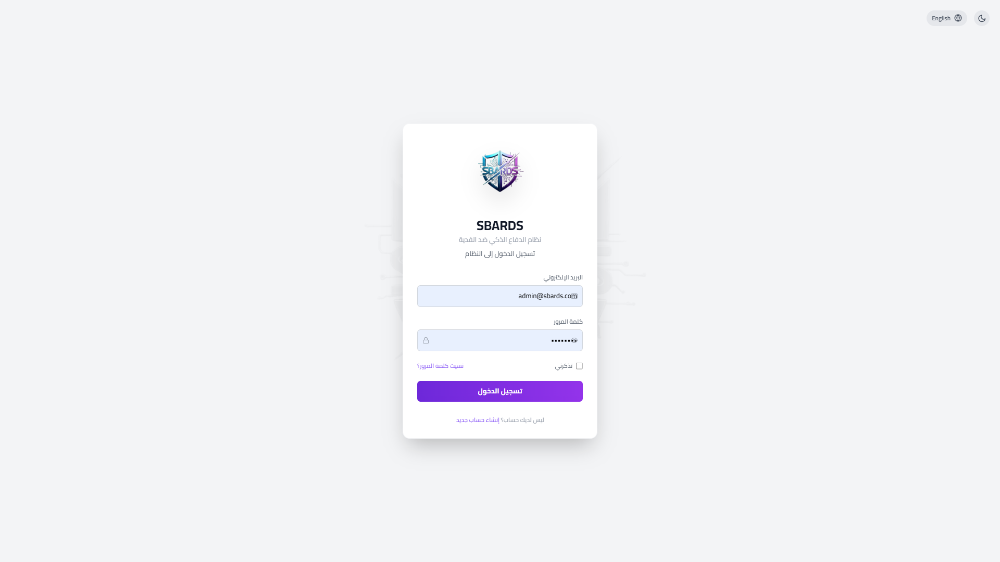

<div align="center">

# 🛡️ SBARDS v2.0.0
### Advanced Security Behavior Analysis & Ransomware Defense System

**نظام تحليل السلوك الأمني المتقدم والدفاع ضد برامج الفدية**

نظام أمني متعدد الطبقات لتحليل الملفات والسلوكيات المشبوهة، واكتشاف التهديدات والاستجابة لها.

[](https://github.com/YounesMAlSalami/SBARDS1)
[](LICENSE)
[](https://www.python.org/)
[](https://isocpp.org/)

</div>

---

## 📌 نظرة عامة | Overview

**SBARDS (Smart Behavioral Analysis and Ransomware Defense System)** هو نظام أمني يهدف إلى تحليل الملفات والسلوكيات المرتبطة بالبرمجيات الخبيثة، مع تركيز خاص على اكتشاف أنشطة برامج الفدية (Ransomware) والتهديدات المتقدمة.

يجمع النظام بين التحليل الثابت (Static Analysis)، والتحليل الديناميكي والسلوكي (Dynamic & Behavioral Analysis)، وآليات الاستجابة للتهديدات، إلى جانب واجهة API ولوحة تحكم لمتابعة حالة النظام ونتائج الفحص.

> 🎉 **SBARDS v2.0.0** — إصدار يركز على التحليل متعدد الطبقات، ومراقبة التهديدات، وتوفير أدوات مركزية لعرض نتائج الفحص.

## 🎯 الميزات الرئيسية | Key Features

- 🔍 **اعتراض ومراقبة الملفات:** متابعة الملفات وفق آلية الالتقاط المعتمدة في النظام.
- 🛡️ **بنية أمنية متعددة الطبقات:** دمج عدة مراحل للتحليل والكشف والاستجابة.
- 🔬 **محللات متخصصة:** تحليل الملفات والشفرة والمستندات والشبكات والمؤشرات.
- 🧠 **تحليل قائم على القواعد والتعلم الآلي:** استخدام YARA ومحرك ML ضمن مسارات التحليل.
- ⚡ **الاستجابة للتهديدات:** توفير آليات للتعامل مع النتائج والأنشطة المشبوهة.
- 🌐 **واجهة API ولوحة تحكم:** عرض حالة النظام والتهديدات ونتائج التحليل.
- 🗄️ **قاعدة بيانات منظمة:** تخزين بيانات الملفات والتقارير والمؤشرات وسجلات التدقيق.

## 📊 مؤشرات الأداء | Performance Metrics

الأرقام التالية هي المؤشرات المذكورة ضمن مواصفات المشروع. ينبغي ربطها بنتائج اختبارات قابلة للتكرار قبل اعتبارها ضمانات أداء عامة.

| المؤشر | القيمة المذكورة |
|---|---:|
| دقة الكشف | 96%+ |
| الإنذارات الكاذبة | أقل من 2% |
| زمن معالجة الملف العادي | أقل من 100 ms |
| معدل المعالجة | 1000+ ملف/ثانية |
| التوافر المستهدف | 99.9% |
| تحسن الأداء مقارنة بالإصدار السابق | 60% |

---

## 🖥️ لقطات من النظام | Screenshots

تُحمّل الصور من مجلد `Images` داخل المستودع. تأكد من أن أسماء الملفات وامتداداتها تطابق المسارات أدناه تماماً؛ GitHub يميز بين الأحرف الكبيرة والصغيرة.

<div align="center">

<table>
  <tr>
    <td align="center" width="50%">
      
      <br><sub>Screenshot 507</sub>
    </td>
    <td align="center" width="50%">
      
      <br><sub>Screenshot 509</sub>
    </td>
  </tr>
  <tr>
    <td align="center">
      
      <br><sub>Screenshot 513</sub>
    </td>
    <td align="center">
      
      <br><sub>Screenshot 514</sub>
    </td>
  </tr>
  <tr>
    <td align="center">
      
      <br><sub>Screenshot 516</sub>
    </td>
    <td align="center">
      
      <br><sub>Screenshot 517</sub>
    </td>
  </tr>
  <tr>
    <td align="center">
      
      <br><sub>Screenshot 518</sub>
    </td>
    <td align="center">
      
      <br><sub>Screenshot 519</sub>
    </td>
  </tr>
  <tr>
    <td align="center">
      
      <br><sub>Screenshot 520</sub>
    </td>
    <td align="center">
      
      <br><sub>Screenshot 521</sub>
    </td>
  </tr>
  <tr>
    <td align="center">
      
      <br><sub>Screenshot 522</sub>
    </td>
    <td align="center">
      
      <br><sub>Screenshot 523</sub>
    </td>
  </tr>
  <tr>
    <td align="center">
      
      <br><sub>Screenshot 524</sub>
    </td>
    <td align="center">
      
      <br><sub>Screenshot 525</sub>
    </td>
  </tr>
  <tr>
    <td align="center" colspan="2">
      
      <br><sub>Screenshot 526</sub>
    </td>
  </tr>
</table>

</div>

---

## 🚀 البدء السريع | Quick Start

### المتطلبات الأساسية | Prerequisites

- Python 3.8 أو أحدث.
- مترجم C++ متوافق: GCC أو Clang أو MSVC.
- ذاكرة RAM بسعة 4 GB كحد أدنى، و8 GB موصى بها.
- صلاحيات المدير مطلوبة لبعض الوظائف المتقدمة، بحسب نظام التشغيل والإعدادات.

### التثبيت | Installation

```bash
# 1. استنساخ المستودع
git clone https://github.com/YounesMAlSalami/SBARDS1.git
cd SBARDS1

# 2. تثبيت متطلبات Python
pip install -r requirements.txt

# 3. بناء امتدادات C++ (إذا كانت مطلوبة في بيئتك)
python setup.py build_ext --inplace

# 4. التحقق من إعدادات النظام
python run.py --test-config

# 5. تشغيل النظام
python run.py
```

### أوامر التشغيل | Basic Commands

```bash
# تشغيل النظام
python run.py

# تشغيل الالتقاط/الفحص على مسار محدد
python run.py --capture --target /path/to/scan

# تشغيل التحليل الثابت
python run.py --static-analysis

# تشغيل واجهة API
python run.py --api --host 0.0.0.0 --port 8000

# فحص متطلبات النظام
python run.py --check-system
```

> **ملاحظة:** تأكد من أن أسماء الأوامر والخيارات أعلاه مطابقة للخيارات المنفذة فعلياً في الإصدار الموجود بالمستودع.

---

## 🏗️ هندسة النظام | System Architecture

يتكون التصميم من ثماني طبقات رئيسية:

| الطبقة | التقنية | الوظيفة |
|---|---|---|
| Capture Layer | C++ / Python | التقاط الملفات ومتابعتها وفق آلية النظام |
| Static Analysis | C++ / Python | التحليل الثابت باستخدام المحللات المتخصصة |
| Dynamic Analysis | C++ / Python | التحليل الديناميكي والسلوكي |
| Response Layer | Python / C++ | تنفيذ إجراءات الاستجابة للتهديدات |
| External Integration | Python / C++ | التكامل مع الخدمات الخارجية مثل VirusTotal |
| Memory Protection | C++ | وظائف حماية الذاكرة |
| Monitoring Layer | C++ / Python | مراقبة حالة النظام ومكوناته |
| API Layer | Python | توفير واجهة REST API |

### المحللات المتخصصة | Specialized Analyzers

1. **YARA Scanner** — مطابقة الملفات مع قواعد YARA للكشف عن الأنماط المعروفة.
2. **Advanced Code Analyzer** — تحليل الشفرة والأنماط البرمجية المشبوهة.
3. **Document Analyzer** — فحص المستندات والماكرو.
4. **Network Analyzer** — تحليل مؤشرات وحركة الشبكة.
5. **URL/IP Analyzer** — تحليل الروابط وعناوين IP.
6. **Permission Analyzer** — تحليل الصلاحيات والأذونات.
7. **Entropy Calculator** — قياس الإنتروبيا للمساعدة في تحديد الملفات ذات المحتوى عالي العشوائية.
8. **ML Engine** — استخدام نماذج التعلم الآلي ضمن عملية الكشف.

---

## 🎨 لوحة التحكم وواجهة API | Dashboard & API

يمكن تشغيل واجهة API باستخدام:

```bash
python run.py --api
```

ثم فتح لوحة التحكم من المتصفح:

```text
http://localhost:8000/dashboard
```

تشمل وظائف الواجهة المذكورة في المشروع:

- **Dark / Light Mode:** التبديل بين الوضع الداكن والفاتح.
- **Real-time Updates:** تحديث البيانات بصورة دورية.
- **Interactive Charts:** عرض المؤشرات والرسوم البيانية.
- **System Health:** متابعة حالة مكونات النظام.
- **Threat Detection:** استعراض التهديدات ونتائج الفحص.

---

## 🗄️ قاعدة البيانات | Database

بحسب تصميم المشروع، تتضمن قاعدة البيانات 16 جدولاً متخصصاً، من بينها:

| المجال | الجداول |
|---|---|
| بيانات الملفات والتحليل | `Files`, `Hashes`, `StaticReports`, `DynamicReports` |
| النتائج وإدارة الوصول | `Verdicts`, `Users`, `AccessControl`, `AuditLogs` |
| التحليل المتقدم | `PermissionAnalysis`, `EnhancedScanReport` |
| قواعد البيانات المرجعية | `VirusHashDatabase`, `WhitelistDatabase` |
| معلومات التهديدات والمقاييس | `ThreatIntelligence`, `SystemMetrics` |

### وظائف قاعدة البيانات

- تشفير البيانات الحساسة باستخدام AES-256، وفق آلية التنفيذ المعتمدة.
- دعم PostgreSQL وSQLite، وفق إعدادات التشغيل.
- النسخ الاحتياطي الدوري.
- تحسين الفهرسة والاستعلامات.

---

## 🔒 الأمان واكتشاف التهديدات | Security & Threat Detection

### وظائف الحماية المذكورة

- حماية البيانات الحساسة في الذاكرة.
- آليات للحد من مخاطر استخراج بيانات الذاكرة.
- الحذف الآمن للملفات وفق آلية التنفيذ.
- فحص سلامة ملفات النظام.
- آليات النسخ الاحتياطي.

### فئات التهديدات المستهدفة

- Malware — البرمجيات الخبيثة.
- Ransomware — برامج الفدية.
- Zero-day Threats — التهديدات التي تستغل ثغرات غير معروفة أو غير مرقعة.
- APT — التهديدات المستمرة المتقدمة.
- Fileless Malware — البرمجيات الخبيثة التي تعمل دون الاعتماد على ملف تقليدي على القرص.

> قدرات الكشف الفعلية تعتمد على قواعد الكشف والنماذج ومصادر البيانات وبيئة الاختبار. لا ينبغي اعتبار أي نسبة كشف ضماناً لاكتشاف جميع التهديدات.

---

## 🧪 الاختبار والجودة | Testing & Quality

لتشغيل الاختبارات:

```bash
# تشغيل مجموعة الاختبارات
python run_tests.py

# اختبارات الوحدة
pytest tests/unit/ -v

# اختبارات التكامل
pytest tests/integration/ -v

# اختبارات الأداء
pytest tests/performance/ -v
```

### مؤشرات الاختبار المذكورة

| نوع الاختبار | النتيجة المذكورة |
|---|---:|
| اختبارات الوحدة | 95% |
| اختبارات التكامل | 92% |
| اختبارات الأداء | 100% |
| تغطية الكود | 85% |

ينبغي إرفاق تقارير الاختبار أو مخرجات CI التي تثبت هذه النتائج عند تقديمها باعتبارها نتائج تحقق رسمية.

---

## 🚀 النشر والتوزيع | Deployment

### Docker

```bash
docker-compose up -d
```

مثال لتوسيع الخدمات، إذا كانت الخدمات والأسماء معرفة في ملف Compose:

```bash
docker-compose up --scale api=3 --scale monitoring=2
```

### Kubernetes

```bash
# تطبيق ملفات النشر
kubectl apply -f deployment/kubernetes/prod/

# متابعة Pods
kubectl get pods -n sbards
```

---

## 📚 التوثيق | Documentation

تتوفر أدلة المشروع التالية في المستودع:

- `README.md` — نظرة عامة ودليل البدء السريع.
- `USER_GUIDE.md` — دليل المستخدم.
- `DEVELOPER_GUIDE.md` — دليل المطور.
- `ADMIN_GUIDE.md` — دليل المدير.
- `CHANGELOG.md` — سجل التغييرات.
- `docs/technical/` — التوثيق التقني.
- `docs/user/` — أدلة المستخدم التفصيلية.
- `docs/admin/` — توثيق الإدارة.
- `tests/` — ملفات الاختبارات.

---

## 🛠️ التشخيص | Diagnostics

```bash
# تشخيص النظام
python run.py --diagnose

# إنشاء تقرير للمشكلة
python run.py --create-issue-report
```

---

## 🤝 المساهمة والدعم | Contributing & Support

للاستفسارات أو الإبلاغ عن مشكلة، يرجى استخدام صفحة Issues في المستودع:

- **Repository:** https://github.com/YounesMAlSalami/SBARDS1
- **Issues:** https://github.com/YounesMAlSalami/SBARDS1/issues

---

## 📄 الرخصة | License

هذا المشروع مرخص بموجب **MIT License**. راجع ملف `LICENSE` في المستودع للاطلاع على النص الكامل للرخصة.

---
<div align="center">

### 🛡️ SBARDS v2.0.0
**Protecting Your Digital World**

Developed by **Younes Al-Salami** and the SBARDS team.

[](https://star-history.com/#sbards/sbards&Date)

</div>
